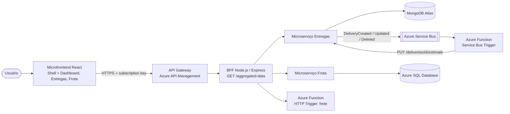

# CloudLog · BFF - Backend for Frontend

Projeto PJBL da disciplina **Arquitetura de Software e Soluções Cloud** (PUCPR) - Prof. Manoel Valerio da Silveira Neto.

## Alunos

- Camilla Augusta Uber
- João Davi
- Laura Guillarducci

## Sobre

BFF do painel web. O microfrontend só conversa com ele (através do API Gateway). Responsável por **agregação de dados**, **proxy do CRUD** e **orquestração** entre o Microserviço de Entregas, o Microserviço de Frota e a Azure Function de frete. O BFF não acessa banco de dados.

## Arquitetura da solução



| Projeto | Repositório |
|---|---|
| Microfrontend (React) | [cloudlog-frontend](https://github.com/laducci/cloudlog-frontend) |
| BFF (Node.js/Express) | [cloudlog-bff](https://github.com/laducci/cloudlog-bff) |
| Microserviço de Entregas (MongoDB) | [cloudlog-entregas-service](https://github.com/laducci/cloudlog-entregas-service) |
| Microserviço de Frota (Azure SQL) | [cloudlog-frota-service](https://github.com/laducci/cloudlog-frota-service) |
| Azure Function (frete + eventos) | [cloudlog-function](https://github.com/laducci/cloudlog-function) |

### Clean Architecture + Vertical Slice

```
src/
├── Domain/          entidades, regras de negócio, erros e portas (interfaces) - sem dependências externas
├── Application/
│   └── Features/    uma pasta por caso de uso (Vertical Slice)
│       ├── GetAggregatedData/  (GET /aggregated-data)
│       ├── ManageDeliveries/ ManageVehicles/ ManageDrivers/  (proxy CRUD)
│       ├── QuoteFreight/  (proxy da Azure Function)
│       └── AssignDelivery/  (regra que cruza Entregas e Frota)
├── Infrastructure/  adaptadores concretos (banco, mensageria, HTTP) que implementam as portas do Domain
└── API/             camada de entrada (Express/Functions), Swagger e Composition Root
```

Regra de dependência (verificada pelos testes de arquitetura com **ArchUnitTS**):
`API → Application → Domain` e `Infrastructure → Domain`. O Domain não conhece nenhuma outra camada,
a Application não conhece Infrastructure nem API, e uma feature não importa outra feature.

## Endpoint obrigatório: `GET /aggregated-data`

Consulta **em paralelo** o Microserviço de Entregas, o Microserviço de Frota e a Azure Function
(cotação em lote das entregas em aberto) e devolve **um único JSON**:

```json
{
  "generatedAt": "2026-11-12T12:00:00.000Z",
  "sources": { "entregas": "ok", "frota": "ok", "freteFunction": "ok" },
  "kpis": { "deliveries": {"total": 3, "byStatus": {"Pendente": 2, "Em rota": 1}}, "fleet": {"utilizationRate": 0.33}, "freight": {"totalFreight": 4892.1} },
  "deliveries": [ { "code": "ENT-1001", "driverName": "Marcos Pereira", "vehiclePlate": "BRA2E19", "freightQuote": { "freightCost": 471.53 } } ],
  "fleet": { "vehicles": [], "drivers": [] },
  "freight": { "items": [], "totalFreight": 4892.1 },
  "warnings": []
}
```

Se uma fonte falhar, as outras continuam na resposta e o problema aparece em `sources` e `warnings`.

## Demais endpoints

| Método | Rota | Destino |
|---|---|---|
| GET/POST/PUT/DELETE | `/deliveries`, `/deliveries/{id}` | Microserviço de Entregas |
| POST | `/deliveries/{id}/assign` | despacho: valida veículo/motorista e atualiza os dois microserviços (com compensação) |
| GET/POST/PUT/DELETE | `/vehicles`, `/drivers` (+ `/{id}`) | Microserviço de Frota |
| GET | `/freight-quote?distanceKm=&weightKg=` | Azure Function (HTTP Trigger) |
| GET | `/docs` · `/openapi.json` | Swagger |

## Tecnologias

- Node.js 22 + TypeScript
- Vitest (testes unitários) + ArchUnitTS (testes de arquitetura)
- Express 4 + swagger-ui-express (OpenAPI 3)
- `fetch` nativo com timeout para chamar os serviços
- Docker (imagem `node:22-alpine`) · Azure Container Apps · Azure API Management na frente

## Endereços na nuvem

| Recurso | URL |
|---|---|
| Frontend (microfrontend) | https://stcloudlogweba6058.z15.web.core.windows.net |
| API Gateway (Azure API Management) | https://apim-cloudlog-a6058.azure-api.net/cloudlog/aggregated-data (header `Ocp-Apim-Subscription-Key`) |
| BFF · Swagger | https://ca-cloudlog-bff.delightfulbeach-476aeb68.brazilsouth.azurecontainerapps.io/docs |
| Microserviço Entregas · Swagger | https://ca-cloudlog-entregas.delightfulbeach-476aeb68.brazilsouth.azurecontainerapps.io/docs |
| Eventos (AsyncAPI) | https://ca-cloudlog-entregas.delightfulbeach-476aeb68.brazilsouth.azurecontainerapps.io/events/docs |
| Microserviço Frota · Swagger | https://ca-cloudlog-frota.delightfulbeach-476aeb68.brazilsouth.azurecontainerapps.io/docs |
| Azure Function · Swagger | https://func-cloudlog-a6058.azurewebsites.net/api/docs |
| Docker Hub | https://hub.docker.com/u/laducci |

## Como rodar localmente

```bash
npm install
cp .env.example .env        # ajuste as variáveis
npm run build
PORT=8080 ENTREGAS_SERVICE_URL=http://localhost:8081 FROTA_SERVICE_URL=http://localhost:8082 FREIGHT_FUNCTION_URL=http://localhost:7071/api npm start
# Swagger: http://localhost:8080/docs
```

> `BFF_GATEWAYS=memory` sobe o BFF com dados em memória, sem depender dos outros serviços.

Com Docker:

```bash
docker build -t cloudlog/cloudlog-bff .
docker run -p 8080:8080 --env-file .env cloudlog/cloudlog-bff
```

Publicação no Docker Hub (`scripts/docker-publish.sh <usuario> v1`):

```bash
docker build -t docker.io/<usuario>/cloudlog-bff:v1 .
docker login docker.io
docker push docker.io/<usuario>/cloudlog-bff:v1
```

## Testes

```bash
npm run test:arch   # testes de arquitetura (ArchUnitTS)
npm run test:unit   # testes unitários
npm test            # todos
```
